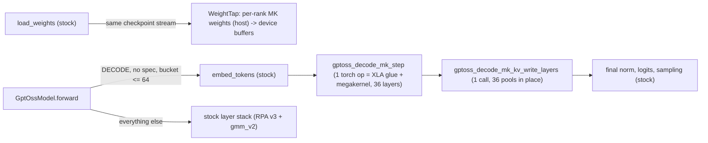

# GPT-OSS decode megakernel in sglang serving (T21 Phase 2, v1)

Status: **CPU-validated integration, never run on a TPU.** The kernel itself is described in
`DESIGN.md`. The integration lives outside this directory, in `sglang_tpu/gptoss_decode_mk/`,
plus two small hooks in `python/sglang/srt/models/gpt_oss.py`. The only kernel changes are
the opt-in `DecodeConfig.split_pools` operand mode and an fp8 clamp of the new K/V.

## Enabling

| Env var | Default | Meaning |
|---|---|---|
| `SGLANG_TPU_GPTOSS_DECODE_MK` | `0` | `1` turns the integration on |
| `SGLANG_TPU_GPTOSS_DECODE_MK_MOE` | `tp` | `tp`: each rank holds an I/8 slice of every expert. `ep`: 16 whole experts per rank |

The rest of the server configuration is unchanged; it targets the CI recipe (`bench_matrix`
gpt_oss_120b × 1host_pc).

## What runs where



- **Load time** (`runtime.WeightTap`, `weights.MkWeightBuilder`): `GptOssForCausalLM.load_weights`
  wraps its checkpoint iterator. Each tensor is copied into this rank's kernel layout before
  it is passed on to the stock loader:
  - MXFP4 experts are pure byte reshuffles. Bytes are read as little-endian uint32 words,
    giving 8 K codes per word with code k at bits 4k. e8m0 scales become exact bf16 powers of two.
  - w13 rows are de-interleaved (gate/up).
  - In TP mode the I dim is split on whole 32-row scale blocks.
  - A bf16 checkpoint (HF dequantized `gate_up_proj` / `down_proj`) is requantized with the
    kernel reference's rule. This is lossless for weights that came from the MXFP4 release.
  - The host copies are uploaded once as non-persistent buffers of a `GptOssDecodeMK`
    submodule (`model.model._tpu_decode_mk`). Stock weights are kept for prefill/extend.
- **Decode** (`runtime.GptOssDecodeMK.run`, `adapter.per_rank_step`):
  - Inputs are the RPA v3 backend's own metadata (`kv_lens`, the rectangular `page_indices`,
    `swa_page_indices`), the stock rotary `cos_sin_cache`, and the 36 per-layer fused pools
    `[pages, 64, 1, packing, 128]`.
  - The mapping is documented in `adapter.py`'s module docstring:
    - `pos = kv_lens - 1`
    - `pt_full / pt_swa = page tables [B, pages_per_seq]`
    - window pages are taken from `pt_swa`
    - the new token is written at `pt[pos // 64]` offset `pos % 64`, where stock RPA writes
      it (`= out_cache_loc` and `full_to_swa[out_cache_loc]` under the paged allocator).
  - Bucket-padding rows (`kv_lens == 0`) attend nothing and write the reserved page 0.

## Design choices (simplest viable; each changes scope)

| Topic | Choice | Why / alternative |
|---|---|---|
| Weight source | Tap the checkpoint stream in `load_weights` | Stock TP8/EP8 shards *whole experts*. TP-split MoE needs an I/8 slice of all 128, which only the checkpoint stream (seen whole by every rank) has. Building from loaded params would need a cross-rank all-to-all, and TPU dequantizes stock experts to bf16 anyway. |
| Weight memory | Separate copy, ~8.7 GiB/rank (`weights.per_rank_bytes`: TP 8.66, EP 8.62 GiB) | See HBM budget below. Sharing would need the stock MoE to run from the same bytes (proposal below). |
| KV pools | Kernel takes 18 SWA + 18 full **per-layer** pool operands (`split_pools=True`) | Stacking the per-layer tensors would copy the pools every step. torch_tpu needs each pool to be its own base tensor for RPA's donation. Inside the kernel, a static `pl.when` per page-DMA start picks the layer pair's ref; waits only need shapes. |
| KV write | ONE non-collective Pallas call writes all 36 layers' new K/V; each pool is donated and aliased to its own output, so the torch op mutates 36 pools in place (`SGLANG_TPU_GPTOSS_DECODE_MK_KV_WRITE=per_layer` gives 36 single-pool calls instead). No `has_side_effects`. | XLA does not alias outputs of a `collective_id` `pallas_call` into live-out buffers (DESIGN.md), so the write is separate from the megakernel. torch_tpu compiles the forward as one SPMD program, and the partitioner rejects unsharded side-effecting custom calls (job j-3f74154c: "Side-effect HLO must have sharding"). Like RPA v3 and `kv_row_write`, the call is kept alive by its aliased outputs. The torch schema marks each pool `Tensor(a!)` through a generated explicit signature. |
| Page tables | Kernel `max_pages = pages_per_seq` of the RPA table (no context cap, no host-side branch) | Keeps the decision static per compiled graph (`fail_on_recompile` safe). SMEM estimate ~650 KiB at B=64, 131k context (risk below). |
| RoPE | Gather the stock `cos_sin_cache` at `pos` (bf16, YaRN incl. `truncate`) | `reference.yarn_tables` always truncates the correction range. The GPT-OSS config uses `truncate: false`, so the kernel reference's tables would differ from stock. |
| When MK runs | `ForwardMode.DECODE`, `spec_info is None`, no `input_embeds`/PP proxy/aux capture, `bs <= 64`, 1 token per request | All are static per compiled graph (mode, shapes), so there is one MK decode graph per batch bucket. EXTEND/MIXED/IDLE/verify/draft run the stock stack. |
| Load-time disable (one log line) | pp>1, attn dp/cp/dcp>1, attn_tp != 8 KV heads, spec decoding, odd layers / non-alternating `layer_types`, head_dim != 64, checkpoint without expert tensors | — |
| Trace-time error | Non-hybrid-SWA pool, pool layout not `[pages, page, 1, packing, 128]`, KV dtype not fp8_e4m3/bf16, KV scales != 1, DCP | The env var is an explicit opt-in. Raising beats a silent fallback that would make the A/B meaningless. |
| fp8 K/V | Clamp to ±448 before the cast (kernel) | Stock `_quantize_kv_to_fp8` clamps. A plain cast to e4m3fn gives NaN on overflow. |

## HBM budget (per rank = per TPU7x TensorCore device) [I]

- MK weights: +8.66 GiB (TP MoE) / +8.62 GiB (EP).
- Stock (CI recipe): GPT-OSS experts are dequantized to bf16 at load. EP8 is 16 experts × 36
  layers × ~25M params × 2 B ≈ 29 GB, plus attention/embeddings/lm_head ≈ 1–2 GB.
- KV pool: `MAX_TOTAL_TOKENS=1572864` fp8. The full pool is ~14.5 GB, plus the SWA pool.
- MK weights are allocated during `load_weights`, before KV sizing. With `mem_fraction_static=0.6`
  the KV pool may come out smaller in the MK arm than in stock. That is irrelevant for the
  ≤64 × 1.5k-token benchmark but should be read off the server log (`KV Cache is allocated`).
- Assuming ~96 GB HBM per device, stock + MK + KV ≈ 55–65 GB fits. **Not checked on hardware.**
- Sharing proposals:
  - (a) Serve prefill MoE from the MK MXFP4 bytes via gmm_v2's native-fp4 path (EP layout)
    and drop the stock bf16 experts. That saves ~20 GB/rank.
  - (b) Use EP MoE mode with an expert layout identical to a native-fp4 gmm_v2 layout, so
    both paths read one copy.

## Validation (CPU only)

`test/registered/unit/hardware_backend/tpu/test_gptoss_decode_mk_serving.py`, 8 virtual CPU
devices, Pallas interpret mode:

| What | Result |
|---|---|
| Checkpoint → per-rank weights vs the kernel's `pack_weights` (TP and EP, all 8 ranks, shuffled stream order) | attention/router/norm/bias operands bit-identical; MXFP4 experts identical after dequant |
| bf16 checkpoint path, and the quantizer vs `reference.mxfp4_quantize` | identical |
| Mutation checks (byte order, gate/up swap, scale off-by-one) | each makes the test fail |
| sglang metadata → kernel operands: `_build_metadata_host` page tables, full→SWA mapping with freed out-of-window pages, page-boundary lengths, bucket padding | write slots == `out_cache_loc` / `full_to_swa[out_cache_loc]`; window pages exact; RoPE rows exact |
| One decode step, tiny dims: repacked weights + 2L per-layer pools + adapter glue through the megakernel, plus the per-layer KV writes, vs `reference.step` (TP/fp8 KV and EP/bf16 KV, one padding row) | rel err 3.5e-3 (same as the kernel's own tests). Only the live rows' new-token slots and page 0 change; K/V match the reference |
| Runtime gating: `applies`, load-time disable reasons, generated op signature | pass |
| Kernel suite `test_gptoss_decode_megakernel.py` (stacked pools) after the kernel edits | unchanged numbers |

## Not validated / risks

1. **Anything on TPU**:
   - torch_tpu custom-op mechanics: a `cpu_export_jax_op` with 53 operands under `shard_map`
     with `P()` per-rank blocks, the remote-DMA kernel inside the compiled decode graph next
     to stock collectives (same `collective_id` 0), and the donation of 36 pools by the
     single write op (no pool copies is expected but unverified; check HBM and HLO).
   - Compile time per bucket, VMEM/SMEM at real dims with `split_pools`. The AOT results in
     DESIGN.md are for stacked pools and `max_pages <= 513`. The serving config uses
     `max_pages = pages_per_seq ≈ 2050` (128k context). That is ~650 KiB SMEM at B=64; it may
     not compile. Fallback options: lower `--context-length`, or page-table streaming in the
     kernel.
2. **Checkpoint format.**
   - The tap expects HF names `model.layers.N.…` with MXFP4 `*_blocks/_scales` or bf16
     `gate_up_proj/down_proj`.
   - The CI recipe passes `QUANTIZATION=unquant`, and the format of
     `gs://junyanxu-benchmark-models/gpt/gpt-oss-120b` was not checked. The job prints the
     checkpoint's `quantization_config`.
   - If neither format is found, the MK disables itself with a log line and the MK arm
     equals stock.
3. **Numerics vs stock** (expected small):
   - The kernel rounds the residual to bf16 after every add. Stock's fused add+norm keeps f32.
   - The MoE accumulation order differs.
   - The kernel uses the same bf16 rope table but applies it in f32.
   - Golden outputs and GSM8K in the job are the check.
4. **Performance gaps (v1)**:
   - Padding rows of a bucket are routed like real rows. Stock gmm also computes them.
   - The KV writes are one extra small kernel launch per step.
   - The MK weights are a second copy.
   - The kernel's long-context × large-batch attention defect (T21 log) applies unchanged.
   - Load time (measured on a Mac CPU, 4 threads): the MXFP4 repack is ~0.1 s/layer.
     A bf16 checkpoint costs ~5 s/layer, about 3 min per rank, plus ~8.7 GiB of host staging
     per rank.
5. **Paths not covered**: spec decoding (EAGLE verify), DP attention, PP, DCP and KV offload
   all keep the stock path or disable the MK at load.

## How to run

```bash
# CPU tests (jax 0.10.2 + torch CPU; ~30 s)
XLA_FLAGS=--xla_force_host_platform_device_count=8 JAX_PLATFORMS=cpu \
  python -m unittest test.registered.unit.hardware_backend.tpu.test_gptoss_decode_mk_serving

# serving A/B on TPU: same server flags, the MK arm adds
SGLANG_TPU_GPTOSS_DECODE_MK=1 bash benchmark/tpu/launch_server.sh
```

## Overhead investigation (after j-b120d683: correct, but ITL c1 6.46 ms vs stock 4.87)

Lead suspect, found by lowering the step op for TPU at real dims on CPU: with code words
stored as int32 the op contains two weight-sized `bitcast_convert`s (w13q 5.2 GB, w2q
2.6 GB per rank). They are inside the manual (`shard_map`) region feeding the Mosaic call.
If XLA materializes them rather than folding them into a bitcast, each step reads and writes
~7.8 GB. At ~3.5 TB/s per device that is ~4.5 ms, which matches the c1 excess. The code words
are now uploaded as genuine `torch.uint32` device tensors (`_to_device`), so the op has no
bitcast; a CPU test checks the TPU lowering. `SGLANG_TPU_GPTOSS_DECODE_MK_U32=0` restores
int32 for an A/B. This is unconfirmed until the HLO dump or xprof shows it.

Diagnostics:
- `SGLANG_TPU_GPTOSS_DECODE_MK_TIMING=1` starts a log every 30 s:
  - MK eager runs (an eager run means the decode forward is not compiled around the
    op, i.e. a graph break or compile off);
  - dynamo graph-break/unique-graph counters with the top reasons;
  - synced step-op/KV-write times if a run happens eagerly.
  `run()` touches the diagnostics only when `torch.compiler.is_compiling()` is False.
  58b1d7d28f called them (a `threading.Lock` context manager) inside the traced region,
  which failed decode precompile in j-b0b0a5fd ("Unsupported context manager").
  `TestRunUnderTorchCompile` now traces `run()` with `fullgraph=True` on CPU for every
  TIMING × ABLATE × KV_WRITE setting.
- `SGLANG_TPU_GPTOSS_DECODE_MK_ABLATE` gives timing-only arms whose outputs are wrong:
  - `noop_kernel`: the same op, operands and glue, but a trivial kernel that only takes the
    operands. It measures marshalling and relayout of the weights/pools.
  - `no_kv_write`: skips the KV write op.
  - `no_mk`: skips both MK ops; this is the floor of embed + norm + logits + sampling.
- `SGLANG_TPU_GPTOSS_DECODE_MK_KV_WRITE=per_layer`: the 36 single-pool write calls.
- `benchmark/tpu/gptoss_decode_mk/hlo_big_ops.py <dump>` lists copy, convert,
  bitcast-convert, collective and fusion ops ≥ 64 MB in the optimized HLO. Dump with
  `LIBTPU_INIT_ARGS="--xla_dump_to=... --xla_dump_hlo_as_text"`.
- The values file wires all of this through `MK_ABLATIONS`, `MK_HLO_DUMP=1` and `MK_KV_WRITE`.

## Kernel 69b2033324 merged (fp8 experts, AR fold / rsag)

- **Experts default to fp8.** The format is e4m3 times a per-column power-of-two scale, the
  kernel's `fp8_pack` rule.
  - The load tap still streams the checkpoint into the MXFP4 layout.
  - `weights.mxfp4_to_fp8` then converts it per (layer, expert block) and counts elements
    that are not exactly representable.
  - The count is logged at load (`MXFP4 -> fp8 experts on rank r: N inexact`). If N > 0, the
    integration stays on the MXFP4 expert path.
  - Tests: the result is bit-identical to `pack_weights(w_dtype="fp8")` for TP and EP.
  - Cost: ~1.5 min per rank on a Mac CPU (unmeasured on the pod), plus ~15 GiB host staging
    per rank.
- **HBM per rank:** fp8 experts are 14.96 GiB (TP) / 14.92 GiB (EP), vs MXFP4 8.66 / 8.62
  GiB. That is +6.3 GiB over the MXFP4 integration; expect ~43.5 GB load mem vs the 37.17
  measured in j-b120d683.
- **Kernel interface:** the kernel takes `newpg [2B]` as an SMEM operand. `split_pools`
  requires `kv_write="scatter"`, so the serving path keeps the separate KV write op.
- **Env knobs for A/B** (prefix `SGLANG_TPU_GPTOSS_DECODE_MK_`; unset means kernel
  defaults):
  - `W_DTYPE=fp8|mxfp4`
  - `AR_MODE=auto|oneshot|rsag`
  - `AR_FOLD=0|1`
  - `NPB`, `NPB_SWA`, `KV_BUFS`, `W_SLOTS`, `VMEM_MIB`
  - `KERNEL_ABLATE=ar,attn,...` (the kernel's own ablations; outputs wrong)

  The effective values are logged in the `decode megakernel ON (...)` line.
