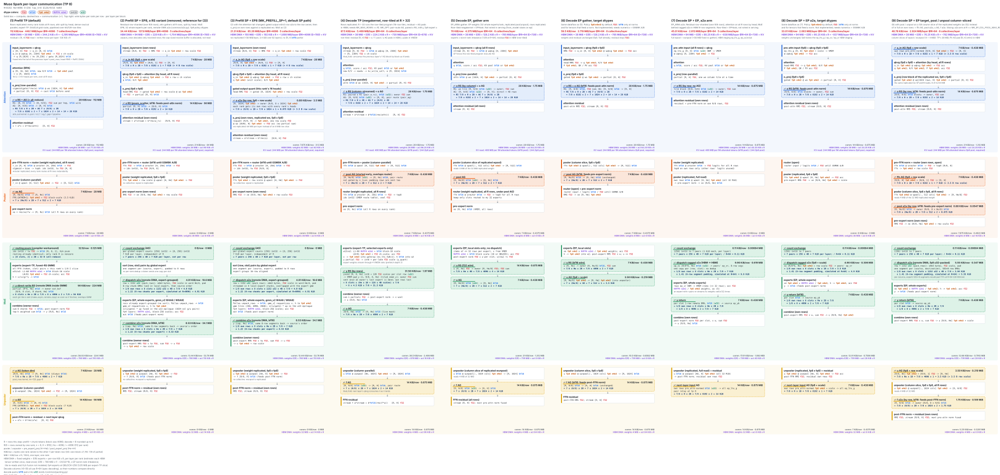
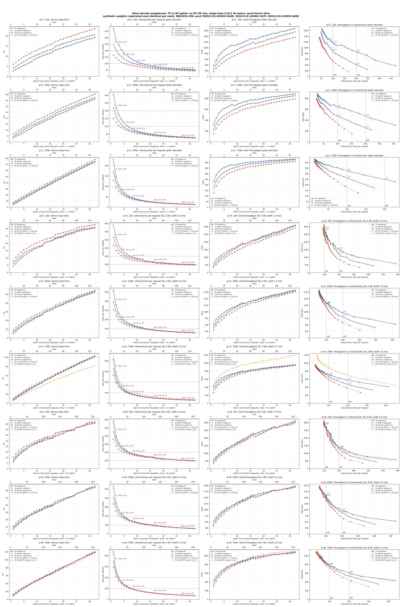
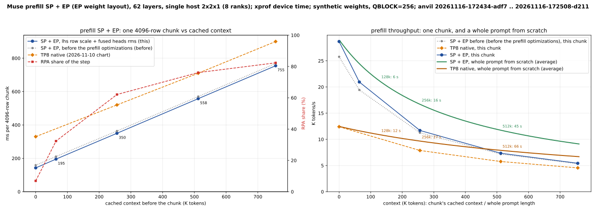

# Muse megakernel communication

Per-layer communication of Muse Spark at TP 8 for the two prefill programs (TP / SP) and the decode megakernel. The diagrams are generated by [gen_diagrams.py](../../benchmark/tpu/muse_megakernel/gen_diagrams.py); when the kernels change, update the data there and rerun:

```bash
python benchmark/tpu/muse_megakernel/gen_diagrams.py
```



Single-column views: [(1) Prefill TP](../../assets/muse_megakernel/comm_prefill_tp.svg) · [(2) Prefill SP, o RS variant](../../assets/muse_megakernel/comm_prefill_sp.svg) · [(3) Prefill SP](../../assets/muse_megakernel/comm_prefill_sp_target.svg) · [(4) Decode TP](../../assets/muse_megakernel/comm_decode_tp.svg) · [(5) Decode EP](../../assets/muse_megakernel/comm_decode_ep_gather.svg) · [(6) EP target](../../assets/muse_megakernel/comm_decode_ep_gather_target.svg) · [(7) Decode SP + EP](../../assets/muse_megakernel/comm_decode_ep_a2a.svg) · [(8) SP + EP target](../../assets/muse_megakernel/comm_decode_ep_a2a_target.svg) · [(9) SP + EP target, sliced pool / unpool](../../assets/muse_megakernel/comm_decode_ep_a2a_sliced.svg)

Columns (1), (3), (4), (5) and (7) show the code as it is; (5) and (7) are not wired for serving. (3) is the SP prefill program: a row all-to-all of the attention output back to the row owners, then the whole wo. (2) is the earlier SP variant with a bf16 o reduce-scatter instead, kept as the reference for (3). (6) and (8) are (5) and (7) under the dtype policy below. (9) is (8) with pool / unpool on column slices of the replicated weights; the decode a2a arm does this at R <= `SGLANG_TPU_MUSE_MK_EP_COL_POOL_MAX_ROWS`, with per-(source, destination) dispatch segments.

## Notation

| Symbol | Meaning |
|---|---|
| R | Rows this step. Prefill uses the chunk, block size **4096**; decode uses B rounded up to a multiple of 8 (<= 32 by default, `SGLANG_TPU_MUSE_MK_MAX_ROWS`) |
| n | TP = 8 (prefill requires 8; decode allows 1 or 8) |
| H / He / I | 8192 residual width / 4096 moe_hidden_size / 4096 expert intermediate (512 per rank) |
| pooler / unpooler | pre_expert_proj (H->He) / post_expert_proj (He->H); both ColumnParallel in the model |
| KiB/row | Bytes one rank sends to the other 7 ranks per token row. AG: own block x7; RS: 7/8 of the partial |
| Formula line | Every comm box in the diagrams ends with its derivation, e.g. `RS 7/8 x H x 2B + AG 7 x (H/8) x 2B = 14 + 14 = 28 KiB`. "1/8 own rows" marks traffic a rank sends only for its R/8 rows, averaged over all R rows |
| MiB | KiB/row x R / 1024, one layer, one rank |

The diagrams color every dtype: <span style="color:#d1242f">**f32**</span>, <span style="color:#1f6feb">**bf16**</span>, <span style="color:#bc4c00">**fp8 e4m3**</span>, <span style="color:#8250df">**NVFP4 e2m1**</span>, **int32**, <span style="color:#0a7d62">**u32**</span>.

## Program selection

| env | Effect |
|---|---|
| `SGLANG_TPU_MUSE_MEGAKERNEL=1` | Enables the megakernel (decode) |
| `SGLANG_TPU_MUSE_MK_PREFILL=1` | Extend / mixed steps use the prefill program (R must be a multiple of 128; KV pools must be fp8 e4m3 SEQ_ALONG_LANE) |
| `SGLANG_TPU_MUSE_MK_PREFILL_SP=1` | Prefill uses SP + EP (3) instead of the default TP ([ops.py](ops.py): `PF_SP.build_forward if cfg.sp else PF.build_forward`); requires `MOE_MODE=ep` |
| `SGLANG_TPU_MUSE_MK_SP_EP_LAYOUT=1` | (3) reads decode EP's weight layout, so prefill SP and decode EP share one copy of the weights (w13 then runs unfused: silu * up after the gmm) |
| `SGLANG_TPU_MUSE_MK_PREFILL_FP8_GATHER=1` | Only affects the xe / u AG of (1), sending fp8 e4m3 + f32 block scales; (3) raises on it |
| `SGLANG_TPU_MUSE_MOE_MODE` | (1) and (4) run `tp` (expert-TP); (3), (5), (7) need `ep`. Serving `from_model` still raises on `ep` (no EP weight load yet), so these are reachable only from kernel-level tests for now |
| `SGLANG_TPU_MUSE_MK_EP_ARM` | EP decode paradigm: `gather` (default, (5)) or `a2a` ((7)) |
| `SGLANG_TPU_MUSE_MK_EP_COL_POOL_MAX_ROWS` | a2a arm: column-sliced pool / unpool up to this many rows (default 16, 0 off) |

## Comparison (per layer, per rank)

| | (1) Prefill TP | (3) Prefill SP + EP8 | (4) Decode TP |
|---|---|---|---|
| Residual | [R, H] f32, rows replicated | [R/8, H] f32, row-sharded | [R, H] f32, rows replicated |
| Attention | Split by head, all R rows | AG to all R rows first, split by head, then a row a2a back to the owners | Split by head, all R rows |
| o_proj | Row-parallel, then RS + AG | Replicated wo on own rows, no partial sums | Row-parallel, then RS + AG |
| Router | wrouter bf16 replicated; every rank routes all R rows (redundant) | wrouter bf16 replicated; each rank routes only its own R/8 rows | Same as (1) |
| pooler / unpooler | Column-parallel, then AG | Weights replicated; local matmul on own rows, no collective | Column-parallel, then AG |
| Experts | expert-TP: each rank holds 1/8 of I for every expert | EP: 32 whole experts per rank (`gmm_v2`) | Same as (1); computes only the selected experts |
| Comm mechanism | `GridColl`: 2 cross-chip hops plus the on-die partner, pipelined over 64/128-row tiles | XLA `all_gather` / `all_to_all`; the MoE a2a is an in-kernel remote-DMA all-to-all ([common/a2a.py](common/a2a.py)) | `Coll` direct: issues 7 remote DMAs at once straight into peer VMEM |
| Kernels per layer | 4 (RPA, attn_out, fused-RS MoE, post_moe) | XLA graph + RPA + `gmm_v2` | One pallas_call for all 62 layers |
| Collectives | 7 | 5 (plus 2 AG after the last layer) | 6 (5 when B <= 2) |
| KiB/row | 112 | 21.3 | 112 (R <= 32) / 87.5 (R=64, row-tiled) |
| MiB/layer | 448 (R=4096) | 85 (R=4096) | 5.5 (R=64) |

Dtypes shared by all programs:

- The residual stream is f32; each branch is rounded to bf16 before it is added back.
- Dense weights: wqkvg / wo / wpool / wunpool are fp8 e4m3 (K-major) with f32 per-output-channel scales. The router is bf16.
- Expert weights in (1) / (4): layers 1-60 are NVFP4 (float4_e2m1fn_x2) with bf16 block-16 scales (e4m3 in the checkpoint, converted to bf16 at load); layers 0 and 61 are fp8 e4m3 with f32 channel scales. (3) takes whole experts as u32 words of e2m1 / e4m3 codes with block scales (production SGLANG_TPU_MUSE_MK_QBLOCK=256); `gmm_v2` takes 4-D scales [E/8, K/block, 1, N], and 3-D ones are reshaped to that before the call. The exact scale dtype comes from the EP weight loader, which is not written yet.
- Routing: ids are int32, tw are f32.

## (1) Prefill TP

| # | Collective | Tensor | Wire dtype | Mechanism | KiB/row | MiB @4096 |
|---|---|---|---|---|---|---|
| 1 | o RS | [R, H] partial -> [R, H/8] | bf16 (f32 sum per hop, cast before send) | attn_out: rs_pair -> rs2_first -> rs2_second | 14 | 56 |
| 2 | o AG | [R, H/8] -> [R, H] | bf16 | attn_out: ag_* | 14 | 56 |
| 3 | xe AG | [R, He/8] -> [R, He] | bf16; e4m3 + f32 scale with FP8_GATHER | attn_out | 7 (3.5) | 28 |
| 4 | routing psum | [R, 8, 2] | bf16 (ids int32 and tw f32 both cast to bf16) | XLA `lax.psum` | 32 B | 0.125 |
| 5 | y direct-write RS | [R*8, He] partial -> owner [R/8, 8, 8, He] | bf16 | per-tile `make_async_remote_copy` inside the GMM | 56 | 224 |
| 6 | y AG | [R/8, He] -> [R, He] | bf16 (unchanged by FP8_GATHER) | post_moe | 7 | 28 |
| 7 | u AG | [R, H/8] -> [R, H] | bf16; e4m3 + f32 scale with FP8_GATHER | post_moe | 14 (7) | 56 |

- Pipelining: attn_out uses `gap=1`, post_moe uses `gap=0`. While tile j's DMAs are in flight, other tiles run o_proj / router / pooler.
- The next layer's input_layernorm + qkvg are fused into the tail of this layer's post_moe.
- #4 is a compiler workaround: routing is already identical on every rank, and only rank 0 contributes nonzero values ([fused_moe.py](../moe/pallas/fused_rs/fused_moe.py)).

## (3) Prefill SP + EP8 (`MK_PREFILL_SP=1`)

[prefill/spep/program.py](prefill/spep/program.py). Each rank owns R/8 rows between layers.

| # | Collective | Tensor | Wire dtype | KiB/row | MiB @4096 |
|---|---|---|---|---|---|
| 1 | a_in AG | [R/8, H] -> [R, H] | fp8 e4m3 + f32 row scale | 7 | 28 |
| 2 | o a2a (by row) | gated [R, 1024] (this rank's 16 heads) -> owner [R/8, 8 x 1024] (own rows, every rank's heads) | fp8 e4m3 + f32 row scale | 0.875 | 3.5 |
| 3 | count exchange (AG) | per-global-expert counts [256] -> [8, 256] | int32 | 7 KiB per layer | ~0 |
| 4 | dispatch a2a, remote DMA ([common/a2a.py](common/a2a.py)) | (row, slot) pairs sorted by global expert -> receive buffer in local-expert, then source order | 1152 u32 per row (`pack_rows`): byte b of word c holds e4m3 element b*He/4 + c, word He/4 the f32 row scale, then lane padding (12.5% over the payload) | 4.91 | 19.6 |
| 5 | combine a2a, remote DMA | the same segments back into each source's sorted order | bf16 (feeds the post-expert norm) | 8.53 | 34.1 |

- Dtypes follow the policy below: e4m3 activations with a row scale go into every dense dot (fp8 x fp8), the AG, the o a2a and the dispatch; experts run W4A8 / W8A8 (`gmm_v2` quantizes x and h); bf16 only on the expert outputs and the unpool output, which feed a norm. q goes to attention in bf16: the prefill RPA's transposed / ones-V tiles take no e4m3 q. The router input stays bf16 until a GSM8K A/B.
- o_proj: each rank requantizes the received [R/8, 8192] to one row scale and runs it against a **replicated wo** [8192, H] e4m3 with f32 accumulate: no partial sums, nothing bf16 on the wire. Cost: wo goes from an 8 MiB row slice to 64 MiB per layer, +3.4 GiB per rank over 62 layers.
- pooler / unpooler weights are replicated, so router, pooler, combine and unpooler run on the rank's own R/8 rows with no collective. Attention is not sequence-parallel: it still gathers all R rows (#1).
- The a2a moves (source, global expert) segments in 8-row chunks: Mosaic DMAs only at HBM-tile-aligned row offsets, 8 rows for u32 / bf16 / f32 and 32 for e4m3, which is why dispatch rows are packed as u32. The receiver's buffer is already grouped by expert, so the expert FFN reads it with no reorder. Rounding each segment up to whole chunks costs 1.22x at R=4096 (simulated; 32-row chunks cost 2.0x and measured 13% slower). A token still sends one copy per slot.
- Local experts are streamed in 4 chunks: chunk j's expert gmm runs while chunk j + 1 arrives and chunk j - 1 returns. Expert groups are 16-row aligned.
- The receive buffer is allocated for the worst case (cap = R*8 + 1792 rows, rounded to 256-row unpack blocks), but a Pallas `unpack_rows` decodes only the rows that arrived, so its size does not show up in HBM traffic.

### (2) o RS variant (removed)

(3) with the attention tail as a bf16 o reduce-scatter ([R, H] partial -> [R/8, H], 14 KiB/row) after a row-sliced o_proj, instead of the e4m3 o a2a and replicated wo. Total 34.4 instead of 21.3 KiB/row (138 vs 85 MiB per layer at R=4096), for 56 MiB per layer less wo.

## (4) Decode TP (megakernel)

The table is the base program (R <= 32, everything in VMEM). R > 32 runs the row-tiled program (16-row tiles, residual and AG pads in HBM; needs `SGLANG_TPU_MUSE_MK_MAX_ROWS` >= R, default 32). With `SGLANG_TPU_MUSE_MK_OPT` (default on) it uses pair-route all-gathers, a paired o RS, fp8 expert x and an **int8 y RS** with 128 f32 scales per slot row: 8 x (4 KiB + 512 B) x 7/8 = 31.5 instead of 56 KiB/row, 87.5 KiB/row in total. The diagram's column (4) shows the R=64 row-tiled program.

| # | Collective | Tensor | Wire dtype | Mechanism | KiB/row |
|---|---|---|---|---|---|
| 1 | o RS (column-streamed) | [R, H] partial -> [R, H/8] | bf16 pairs in u32; owner sums in f32 | `reduce_scatter_cols_streamed`: each wo column tile is sent as soon as it finishes, own block last | 14 |
| 2 | o AG | [R, H/8] -> [R, H] | bf16 (u32) | `Coll.all_gather`; folded into the wpool / router matvec with fold_o | 14 |
| 3 | pool AG | [R, He/8] -> [R, He] | bf16 (u32) | Started early to overlap router / top-k; padding rows are sent too | 7 |
| 4 | y RS (by rows) | ysend [R, 8, He] -> pad_y [n, R/8, 8, He] | bf16 (u32); owner sums in f32 | `reduce_scatter_rows`: an owner's block is sent once its last expert finishes; gated by n_live | 56 |
| 5 | u AG | [R/8, He] -> [R, He] | bf16 (u32) | `Coll.all_gather` with a live mask | 7 |
| 6 | f AG | [R, H/8] -> [R, H] | bf16 (u32) | With fold_f, only started here; the next layer's qkvg consumes it as it lands | 14 |

- When B <= 2 (few-row), #1 and #2 merge into one `gather_few` of the full [F, H] bf16 partial: 112 KiB/row.
- Weight streaming: each layer's dense weights form 30 tiles in a ring buffer, prefetched `depth` tiles ahead across matvec and layer boundaries. Expert weights use 4 VMEM slots with prefetch depth 3.
- KV pools can be bf16 fused or bf16 / fp8 e4m3 SEQ_ALONG_LANE. New K/V come out as newkv and a separate `kv_write_call` writes them back to the pools.

## (5)-(8) Decode EP vs SP + EP

If prefill runs SP + EP, decode has to read the same weights: experts become 32 whole experts per rank, and pooler / unpooler are stored replicated. [decode/spep/](decode/spep/) implements two paradigms on the row-tiled megakernel (an `EPHook`), picked by one explicit switch, `SGLANG_TPU_MUSE_MK_EP_ARM`:

- `gather` (default): **EP**, every row on every rank. Columns (5), and (6) with target dtypes.
- `a2a`: **SP + EP**, each rank owns R/8 rows, the MoE behind ragged all-to-alls. Columns (7), and (8) with target dtypes.

Both run at any R that is a multiple of 16 (EP forces the row-tiled program), except that the gather arm's replicated per-row VMEM buffers cap it at 128 rows (it raises above). All decode columns use R=64: with spec decoding a decode step carries several draft rows per request, so R=32 understates it.

| # | (5) gather, rows replicated | KiB/row | (7) a2a, rows sharded | KiB/row @R=64 |
|---|---|---|---|---|
| 1 | o RS by column, bf16 (u32), f32 sum | 14 | o RS by row, bf16 (u32), f32 sum; no AG | 14 |
| 2 | o AG, bf16 (u32) | 14 | count exchange, [256] int32 per peer, 7 KiB per layer | 0.11 |
| 3 | pool AG (column slice of replicated wpool), bf16 (u32) | 7 | dispatch ragged a2a, HBM ep_xs -> ep_xr, bf16 (u32), one copy per (row, slot) | ~9.9 (7 nominal) |
| 4 | u RS, **f32** wire | 14 | y return, 1-row remote DMA per slot, bf16 (u32) | 7 |
| 5 | u AG, bf16 (u32) | 7 | next-layer input AG to every ep_lhs_g, bf16 (u32), pair relay | 14 |
| 6 | f AG (column slice of replicated wunpool), bf16 (u32) | 14 | | |
| | **Total** | **70** | **Total** | **~45** |

- a2a moves per-(source, destination) segments in 8-row DMAs. At R=64 a rank has 64 (row, slot) pairs, ~8 per destination, and padding each destination's segment up to a multiple of 8 costs 1.41x the nominal 7 KiB/row (simulated).
- The gather arm sums the K slot outputs locally (norm and router weight applied per slot) before its RS, so its MoE output RS is [R, He] instead of expert-TP's [R, 8, He]: 14 instead of 56 KiB/row. Its u RS is f32 on the wire; bf16 halves it (column (6)).
- The gather arm reads only its column slice of the replicated wpool / wunpool (4 + 4 MiB). The a2a arm runs pooler / unpooler on own rows and reads both in full (32 + 32 MiB), except at R <= `SGLANG_TPU_MUSE_MK_EP_COL_POOL_MAX_ROWS`, where it uses column slices as in (9).
- Experts stream only if selected; an expert with n pairs is split into items of <= 32 rows and **re-streams its weights once per item**. No capacity factor or rebalancing: the busiest rank sets the step time, the same in both paradigms.
- Target dtypes ((6), (8)) cut ICI bytes and run the dots at fp8 MXU rate, but do not change HBM DMA: decode HBM traffic is weights (already fp8 / fp4) plus KV, and the activations live in VMEM. What they do change is the KV pool: fp8 is required, against bf16 or fp8 today (244 vs 488 MiB per 1M attended tokens).
- Gather is the default because it beats a2a up to 128 rows (fewer latency-bound collective rounds, see [Findings](#findings)); above 128 rows only a2a runs.

## (9) Decode SP + EP target, pool / unpool column-sliced

Goal: EP decode only has to match TP, with the weight layout SP prefill reads on one host. (9) is (8) with one change: pool / unpool run on this rank's 1/8 output-column slice of the replicated wpool / wunpool, over all R rows, as (5) does, instead of in full on own rows. Each rank reads 4 + 4 instead of 32 + 32 MiB, so the fixed weight reads go back to TP's 38 MiB per layer (26 / 8 / 4), down from 94 in (8). The rest is (8): e4m3 a_in AG before attention, o_proj on this rank's row block of the replicated wo (the same tensor SP prefill reads), then a bf16 RS by row; MoE dispatch as a remote-DMA a2a of u32-packed e4m3 rows, y returned in bf16.

| # | (4) Decode TP, R=64 row-tiled | KiB/row | (9) | KiB/row @R=64 |
|---|---|---|---|---|
| 1 | o RS (column-streamed), bf16 | 14 | a_in AG, e4m3 + row scale | 7 |
| 2 | o AG, bf16 | 14 | o RS by row, bf16 (feeds post-attn norm) | 14 |
| 3 | pool AG, bf16 | 7 | ffn AG, e4m3 + row scale (the pooler needs every row) | 7 |
| 4 | y RS, int8 + f32 scales | 31.5 | pool a2a by row to the owner, bf16 (feeds pre-expert norm) | 0.875 |
| 5 | u AG, bf16 | 7 | count exchange, 7 KiB per layer | 0.11 |
| 6 | f AG, bf16 | 14 | dispatch a2a, 1152 u32 per (row, slot), per-(source, destination) 8-row segments, 1.41x | 5.55 |
| 7 | | | y return, bf16 | 7 |
| 8 | | | u AG, e4m3 + row scale | 3.5 |
| 9 | | | f a2a by row to the owner, bf16 (feeds post-FFN norm) | 1.75 |
| | **Total** | **87.5** | **Total** | **46.8** |

- A column slice produces whole output columns, not partial sums. So the pool output and the unpool output each go to the row owner by an a2a (#4, #9) rather than an RS. A K-split unpool (row slice of wunpool, partial [R, H] output, bf16 RS by row) also reads 4 MiB but costs 14 + 0.44 KiB/row instead of 3.5 + 1.75.
- Comm is 46.8 KiB/row, 53% of TP. That is not under half: the ffn AG (7) and the u AG (3.5) that slicing adds cost more than (8)'s 33 KiB/row saves. The attention pair (a_in AG + o RS, 21 KiB/row) is the largest item.
- The dispatch keeps per-(source, destination) segments, as the decode a2a arm does ([decode/spep/route.py](decode/spep/route.py)). Prefill's per-(source, expert) SEG=8 segments would pad 7.17x at R=64 (simulated, ~57 hit experts across 64 pairs per source): 28 KiB/row dispatch and 50 combine, which would put (9) above TP.
- HBM: 38 MiB + E(R) + 76 KiB x R = ~782 MiB at R=64. Without expert imbalance (E = 678 instead of 739) that is ~721 MiB, TP's ~730. The slope adds an ffn AG pad [R, H] e4m3 in HBM (16 KiB x R) to (8)'s.

## HBM DMA (per layer, per rank)

Modeled as **fixed + E(R) + slope x R**: dense weights are fixed; activations and new-K/V writes scale with rows; expert weights depend on how many experts the step hits. Estimate: each tensor that lands in HBM counts as written once and read once; kernel tile re-reads and XLA fusion are not modeled.

- E(R) = 780 MiB x (1 - (31/32)^R): 780 MiB is all of a layer's expert bytes one rank holds (fp4, QBLOCK=256; 3.05 MiB per expert-TP slice, 24.4 MiB per whole expert), and 1 - (31/32)^R is the chance a given expert is hit by R rows of top-8-of-256. It saturates at R ~ 128.
- EP layouts multiply E(R) by the worst rank's imbalance (simulated: 1.48 / 1.19 / 1.09 / 1.02 / 1.00 at R = 8 / 32 / 64 / 128 / 512), since the busiest rank sets the step.

| | Fixed weights, MiB (attn / pool / unpool) | Experts | Act + KV writes, KiB x R (attn / pool / MoE / unpool) | Total |
|---|---|---|---|---|
| (1) Prefill TP | 38 (26 / 8 / 4) | E(R), tp | 344 (77 / 9 / 193 / 65) | ~2,195 MiB @R=4096 |
| (2) Prefill SP, o RS variant | 94 (26 / 36 / 32) | E(R), ep | 220 (90 / 6 / 110 / 14) | ~1,754 MiB @R=4096 |
| (3) Prefill SP + EP8 | 150 (82 / 36 / 32): replicated wo | E(R), ep | 192 (62 / 6 / 110 / 14): no [R, H] bf16 partial | ~1,698 MiB @R=4096 |
| (4) Decode TP | 38 (26 / 8 / 4) | E(R), tp | 224 (96 / 16 / 16 / 96): row-tiled residual + AG pads in HBM | ~730 MiB @R=64 |
| (5) Decode EP | 38 (26 / 8 / 4) | E(R), ep | 128 (64 / 0 / 0 / 64): residual in HBM | ~785 MiB @R=64 |
| (6) EP target | 38 (26 / 8 / 4) | E(R), ep | 128 (64 / 0 / 0 / 64) | ~785 MiB @R=64 |
| (7) Decode SP + EP | 94 (26 / 36 / 32) | E(R), ep | 88 (40 / 0 / 40 / 8) | ~838 MiB @R=64 |
| (8) SP + EP target | 94 (26 / 36 / 32) | E(R), ep | 60 (24 / 0 / 28 / 8) | ~837 MiB @R=64 |
| (9) SP + EP target, sliced pool / unpool | 38 (26 / 8 / 4) | E(R), ep | 76 (24 / 16 / 28 / 8): ffn AG pad in HBM | ~782 MiB @R=64 (~721 without imbalance) |

KV is listed separately because it scales with context, not R: **244 MiB per 1M attended tokens** per layer per rank (2 KV heads x 64 x K,V x 1 B = 256 B per token; a bf16 pool doubles it). New K/V writes are 256 B per new token (1 MiB per 4096-row chunk). Sliding layers cap the attended tokens at the 2048 window per request.

- **SP's MoE does not pay for its worst-case receive buffer.** The remote-DMA a2a needs no zero-fill, sort or scatter, and `unpack_rows` decodes only received rows: ~110 KiB x R instead of ~1,125 KiB x R for materializing every receive-side tensor at cap = R*8 rows.
- **Replicated pooler / unpooler cost weights, not comm.** Wherever pool / unpool run on own rows ((2), (3), (7), (8)) the fixed part is 94 instead of 38 MiB; (9) reads only column slices and is back at 38, and each rank holds 56 MiB x 62 layers = 3.4 GiB more HBM. (3) also replicates wo: another 56 MiB per layer, 3.4 GiB.
- **(1) moves the f32 residual [R, H] in and out twice per layer** (attn_out, post_moe): 128 KiB x R, 512 MiB at R=4096. SP keeps only R/8 rows of it.
- **(4) decode is weight-bandwidth bound:** HBM traffic is 38 MiB + E(R) + 224 KiB x R (the row-tiled program keeps the residual and AG pads in HBM; at R <= 32 the base program keeps them in VMEM and the slope is 0.25); E(64) = 678 MiB.

- **Decode: EP vs expert-TP.** Decode is weight-bandwidth bound, and EP loses expert-TP's perfect balance: each rank streams only its own selected experts and the busiest rank sets the step. Simulated over uniform routing:

  | R | experts hit | expert-TP weights / rank | EP worst rank | imbalance |
  |---|---|---|---|---|
  | 8 | 57 | 175 MiB | 260 MiB | 1.48x |
  | 32 | 163 | 498 MiB | 590 MiB | 1.19x |
  | 128 | 252 | 767 MiB | 781 MiB | 1.02x |
  | 512 | 256 | 781 MiB | 781 MiB | 1.00x |

- **At R=64:** (4) TP moves 5.5 MiB of comm and ~730 MiB of HBM per layer; (5) EP 4.4 MiB and ~785 MiB; (7) SP + EP 2.8 MiB and ~838 MiB; (9) 2.9 MiB and ~782 MiB. Each step down in comm costs more weight DMA (EP imbalance x1.09, then full replicated pool / unpool reads): (7) beats (4) only if ICI is more than ~40x slower per byte than HBM, less whatever comm the megakernel hides under weight streaming.
- **The weight layout forces EP in decode, not SP.** Whole experts per rank and replicated pool / unpool follow from sharing prefill's weights. Row sharding does not: the gather arm keeps rows replicated and reads only column slices of the replicated pool / unpool.

## Dtype policy (target)

Default is fp8 e4m3; high precision only where a norm is computed. The diagrams show the current dtypes; this table lists where decode and prefill TP deviate from the target. Prefill SP (3) already follows it except for q and the router input.

| Tensor | Current | Target | Note |
|---|---|---|---|
| Residual stream | f32 | f32 | Accumulates across layers and feeds every RMS |
| RMS math (input / head q,k,o / post-attn / pre-FFN / pre-expert / post-expert / post-FFN) | f32 | f32 | The norm itself |
| a_in after input_layernorm, and the SP a_in AG | bf16 | **fp8** + scale | AG 14 -> ~7 KiB/row; reuse coll.py `to_fp8` / `gathered` |
| qkvg / o_proj / pooler / unpooler matmuls | bf16 x fp8 (mixed, bf16 MXU rate) | **fp8 x fp8**, f32 acc | Weights are already fp8 e4m3 |
| q | bf16 | **fp8** | Prefill SP stays bf16: the prefill RPA's transposed / ones-V tiles take no e4m3 q |
| K / V pool | fp8 | fp8 | Done |
| P (softmax output) | bf16 | **fp8** | |
| Gated attention output into o_proj | bf16 | **fp8** | |
| o RS partials | bf16 (TP: f32 sum per hop) | bf16 | The sum feeds the post-attention norm. Prefill SP (3) has no RS: e4m3 row a2a, then o_proj with f32 acc |
| xe after pre-expert norm, and the dispatch a2a | bf16 | **fp8** + scale | Dispatch 7 -> ~3.5 KiB/row |
| Expert h = silu(g)*u into w2 | bf16 | **fp8** | |
| Expert y, and the combine a2a / y RS | bf16 | bf16 | Feeds the post-expert norm |
| u into unpooler | bf16 | **fp8** | |
| f (unpooler output) | bf16 | bf16 | Feeds the post-FFN norm |
| Router input / logits | bf16 / f32 | open | top-k selection is sensitive; decide with GSM8K |

Each target still needs numerics + GSM8K A/B; decode ((6), (8)) and prefill TP have not adopted it.

## Decode sweep, (4) TP vs (5) EP gather vs (7) SP + EP a2a



All 62 layers, xprof device time on the slowest chip, single host 2x2x1, QBLOCK=256, fp8 SEQ_ALONG_LANE KV, every request at the same context (32k / 256k / 756k); q = rows per request (1: decode, 4 / 8: DFlash verify). Up to 128 rows the gather arm beats the a2a arm at every point; its gap to TP shrinks with rows and context (1.3-1.5x at b1, ~1.0x at q8 b8), the rest being expert imbalance. The a2a arm reaches TP at 256 rows (q8 x b32). The purple line is the EP cut strategy (gather up to 128 rows, a2a above); the right column plots total throughput against interactivity.

## Prefill SP + EP over the cached context



All 62 layers, one 4096-row chunk of one request on (3) with the decode EP weight layout, xprof device time, same setup as the decode sweep. Attention is the batched RPA in [attention/pallas/batched_rpa](../attention/pallas/batched_rpa) (transposed tiles, ones-V row sums, exp2 softmax, full-tile mask skip). Each 1k of context adds ~0.81 ms to the chunk, about TP8's 0.75 ms: the attention work is the same (an AG of a_in, then this rank's heads over every row). Against the TP8 / PP8 serving reference (same chunk and contexts, 8 chips, xprof device time):

| cached context | TP8 native | TP8 mk-prefill | PP8 W4A16, pipeline full | SP + EP |
|---|---|---|---|---|
| 0 | 330 ms, 12.8k tok/s | 357 ms, 11.5k | 38.3k tok/s | 143 ms, 28.7k |
| 256k | ~520 ms, 7.9k | 568 ms, 7.2k | 14.2k | 350 ms, 11.7k |
| 512k | ~710 ms, 5.8k | 781 ms, 5.2k | 8.9k | 558 ms, 7.3k |
| 756k | ~900 ms, 4.6k | 982 ms, 4.2k | 6.6k | 755 ms, 5.4k |

SP + EP beats TP8 at every context (2.3x at none, 1.19x at 756k); PP8 stays ahead on throughput, so SP + EP's case is latency and the decode-compatible weight layout.

At ctx 0 the expert gmm takes ~51 ms of the chunk and RPA ~10; the rest is exposed communication (~30 ms: row AG, MoE combine and wait, o a2a), small XLA ops (~25 ms: rms and e4m3 row quantization, gathers back to own-row order, routing pack), dense matmuls (~12 ms, ~64% of the fp8 peak) and the EP weight layout (~14 ms: `unpack_rows` decoding to bf16 for gmm to requantize, `silu_mul_chunks` because w13's per-chunk gate / up columns stop gmm from fusing silu). Open directions:

- Combine writes y straight into own-row order (~4 ms): removes the gather back from the expert-sorted order.
- Fuse rms and e4m3 quantization into a few Pallas kernels (~8-10 ms).
- Overlap communication with compute by micro-batching the chunk in two halves (most of ~30 ms).
- Teach gmm the per-chunk gate / up layout for a fused silu (~5.8 ms); a second, prefill-only weight layout would double expert HBM.

## Observations

- **(3) moves about 5x less comm than (1)** (21.3 vs 112 KiB/row). Its MoE costs 13.4 KiB/row (fp8 dispatch + bf16 combine) against 63 KiB/row for expert-TP in (1) (routing psum + y RS + y AG); replicated pooler / unpooler also drop the xe and u AG (21 KiB/row).
- **In (1) and (4) the MoE combine is about half the traffic.** The y RS costs 56 KiB/row (top_k x He x bf16 x 7/8), which is inherent to expert-TP: every (token, slot) must send 8 partials to its owner.
- **What (3) still spends on attention is the a_in AG** (7 + 0.875 KiB/row with the o a2a), because attention is split by head; removing the AG needs context parallelism.
- **(4) has the same dataflow as (1)**, both 112 KiB/row; only the implementation differs. (4) is a single kernel with direct one-shot sends and bf16 packed into u32; (1) is several kernels using the GridColl grid route with tile pipelining.

## EP decode (not wired)

[decode/spep/](decode/spep/) uses an `EPHook` to replace the o_proj collectives and the FFN section of the row-tiled megakernel. `SGLANG_TPU_MUSE_MK_EP_ARM` picks the arm:

- **gather arm** (default, R <= 128; raises above): the u partial goes over the wire as **f32** in its RS.
- **a2a arm** (`a2a`, any R): o RS by rows, ragged A2A dispatch in per-(source, destination) segments, y written back row by row, then an AG of the next layer's input.

Both arms need replicated wpool / wunpool and 32 whole experts per rank. Serving has no matching weight load: `MuseMegakernel.from_model` raises when `resolve_moe_mode == "ep"`, and only `test/manual/tpu/test_muse_megakernel_numerics.py --ep` reaches this path.

## Code map

| What | Where |
|---|---|
| Program selection, weight packing | [ops.py](ops.py) |
| Prefill TP | [prefill/tp/program.py](prefill/tp/program.py), [attn_out.py](prefill/tp/attn_out.py), [post_moe.py](prefill/tp/post_moe.py) |
| Prefill SP + EP | [prefill/spep/program.py](prefill/spep/program.py), [common/a2a.py](common/a2a.py) (remote-DMA MoE a2a), [moe/pallas/gmm_v2.py](../moe/pallas/gmm_v2.py) |
| Decode TP | [decode/tp/kernel.py](decode/tp/kernel.py) (build, layer loop), [attn.py](decode/tp/attn.py) / [moe.py](decode/tp/moe.py) (untiled), [tiled_attn.py](decode/tp/tiled_attn.py) / [tiled_moe.py](decode/tp/tiled_moe.py) / [tiled_layer.py](decode/tp/tiled_layer.py) (row-tiled), [common/stream.py](common/stream.py), [common/plan.py](common/plan.py) |
| Decode SP + EP | [decode/spep/](decode/spep/) (EPHook arms), [common/a2a.py](common/a2a.py), [common/ep_layout.py](common/ep_layout.py) (weight layout shared with prefill SP) |
| Comm primitives | [common/coll.py](common/coll.py) (`Coll` for decode, `GridColl` for prefill TP), [common/packing.py](common/packing.py) |
| fused-RS MoE | [moe/pallas/fused_rs/](../moe/pallas/fused_rs/) |

## Findings

Why the current design looks the way it does (2x2x1 single host, xprof device time).

### Decode

- **Gather is the default EP arm: it beats a2a up to 128 rows.** At small R each collective round costs a few us of latency whatever its bytes; the a2a arm takes about 9 rounds per layer (o row RS in 8-row blocks, row gather + block return around pool and unpool, count exchange, next-layer row gather) against the gather arm's 4-5.
- **The gather arm's gap to TP is mostly expert imbalance.** The busiest rank holds ~15.5 experts against a mean of 11.2 and sets the step; TP splits every expert evenly.
- **The gather arm stops at 128 rows.** Its replicated per-row VMEM buffers total ~110-125 KiB/row; at 136 rows the program needs 62-90 MiB of the ~64 MiB VMEM.
- **The expert loop is not DMA-bound.** A 3 MiB chunk's four DMAs take 0.91 us (3.5 TB/s), under the q8 arm's 0.97 us of compute.
- **Column-sliced pool / unpool on the a2a arm pays only at 16 rows** (hence `SGLANG_TPU_MUSE_MK_EP_COL_POOL_MAX_ROWS=16`): above that, gathering every row's full input costs more ICI time than the 56 MiB of weight reads it saves.
- **The a2a arm's o RS sends per column tile** so they overlap the o_proj matmul; one send per owner at the end loses the overlap and moves mostly 8-row padding.
- **EP decode MoE tiles.** An item is at most 32 rows of one expert, run on the q8 / q16 / q32 arm; a busier expert splits into items, each re-streaming the expert's weights. Weights stream in I-chunks of 512 (3 MiB); w13 runs one 256-column block at a time, w2 512-column tiles; K = 4096 goes in 16 blocks of 256, each partial scaled by its block scale, which is cheap at R <= 32.

### Prefill SP + EP (one 4096-row chunk)

- **Long context is attention; short context is the MoE.** At 756k the global RPA is ~79% of the chunk; at ctx 0 it is ~3 ms against ~51 ms of expert gmm and ~80 ms of MoE a2a and other XLA ops.
- **The fp4 expert gmm is VALU-bound by per-block partial rescaling.** fp4 x fp8 with block-256 scales makes 16 partials per [tm x tn] at K = 4096; popping, casting, scaling and accumulating them is ~20k of ~24k VALU ops per step. Hence `lhs_scale_per_row`: one lhs row scale per K tile drops one of the two multiplies per partial.
- **Expert gmm tiles are (256, 4096, 2048) with 4 MoE chunks.** tm=128 re-unpacks the same fp4 weight tile for the second row step of most experts; tm=512 pads ~3/4 of the MXU work at ~128 rows per expert; 2 chunks hide less of the a2a, 8 chunks add fixed cost per gmm call.
- **Weights are not requantized to e4m3 in VMEM.** It is ~24% faster per gmm, but rounding fp4 code x scale to e4m3's 3 mantissa bits raises the error vs f32 from 2.7% to 3.6%; adopting it needs a GSM8K check.
- **The expert lhs is fed as bf16 from `unpack_rows`.** gmm_v2's quantized-lhs path is faster than its unquantized one, and a u8 -> float8 bitcast of the dispatched rows is materialized by XLA over the whole receive buffer.
- **Expert scales enter gmm_v2 as 4-D [E, K/block, 1, N].** 3-D scales are reshaped before the call; the relayout copy hides under the async row AG, so a second scale layout in the shared kernel does not pay.
- **Per-head rms is one fused op in the XLA prefill path** (`numerics.heads_rms_xla`, bit-identical); the per-head slice / rms / concat form stays in the decode Pallas kernels, where a 3-D reshape costs a relayout.
- **`fp8_gather` and W4A16 do not apply to SP + EP.** `SGLANG_TPU_MUSE_MK_PREFILL_FP8_GATHER` targets the TP prefill's xe / u all-gathers, and (3) raises if it is set; `w4a16_layers` routes TP prefill's fp4 layers to the fused-RS W4A16 kernel, while SP + EP always runs `gmm_v2`.
